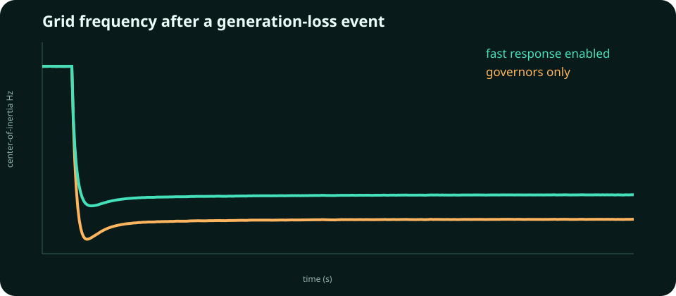

# Grid Stability Control

A multi-area power-system simulator for one of the grid's fastest control
problems: arresting frequency decline after generation loss while respecting
battery power and energy constraints.



The model includes:

- heterogeneous regional inertia and load damping;
- electromechanical tie-line exchange between areas;
- turbine-governor response with regional time constants;
- a generation-loss contingency and seeded load noise;
- battery droop plus synthetic-inertia response;
- response lag, power saturation, and finite energy budgets;
- center-of-inertia frequency, nadir, RoCoF, and throughput metrics.

```bash
python -m pip install -e .
python -m grid_stability_control
python -m grid_stability_control --no-battery
pytest -q
```

Controlled and baseline runs can share an identical disturbance path, so the
effect of fast-frequency response is measurable rather than anecdotal. Tests
verify improved modeled nadir and recovery, deterministic seeded behavior, and
hard actuator limits. RoCoF remains reported separately because a response lag
can improve the nadir without changing the first post-contingency instant.

## Limits

This is a low-order transient-frequency research model. It omits voltage and
reactive-power dynamics, protection relays, converter switching, detailed
governor models, and network power flow. Parameters are illustrative. It is
not an operator tool, interconnection study, or basis for protection settings.
